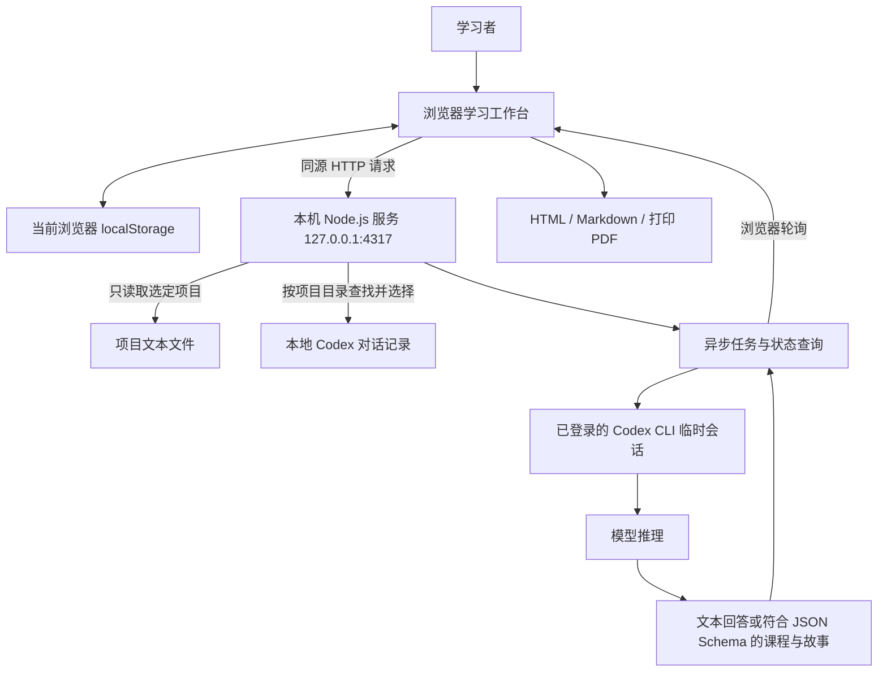

# 知序 Learnmore 架构

## 目标与学习流程

把用户选择的近期项目对话、项目文本或学习材料，组织为可阅读、可追问、可练习的课程。

1. 选择材料并核对上下文。
2. 生成通俗概览与分章课程，以课件或书本模式阅读。
3. 结合当前章节、题目和最近问答向老师提问。
4. 按武侠、科幻、言情或自定义风格生成教学故事，选择自动或手动篇幅。
5. 查看名词、公式、符号定义、适用条件和计算例子。
6. 完成简易、适中、困难三档计算题，获取判题、提示及逐步解析。
7. 导出完整 HTML 阅读版、课程 Markdown、名词公式速查表、故事，或通过浏览器打印为 PDF。

首版提供一套完整的机器学习示例课程。新材料生成的课程会替换当前学习内容；故事根据当前课程单独生成。

## 总体结构



前端使用原生 HTML、CSS 和 JavaScript ES Modules；后端使用 Node.js 内置模块，无 npm 运行依赖。文档解析单独使用 Python：DOCX/PPTX 用标准库，文字 PDF 用 pypdf。页面与接口由同一个本机服务提供，不需要独立数据库或在浏览器保存 API Key。

界面是一个学习工作台：上方为拖放/文件选择区，中间为概览、课程、故事、名词公式和练习，下方为常驻对话。对话与阅读内容分别滚动，不使用覆盖正文的浮动面板。多余的侧边栏、统计卡片和装饰区已移除。

## 文件与职责

| 路径 | 职责 |
| --- | --- |
| `dist/index.html` | 网页入口、元信息与静态资源引用 |
| `dist/styles.css` | 响应式布局、阅读模式、问答区域与打印样式 |
| `dist/app.mjs` | 学习页面状态、材料管理、上下文组装、任务轮询、存储与导出 |
| `dist/views.mjs` | 简化后的单页布局、材料区域、知识概览与常驻对话视图 |
| `dist/files.mjs` | 文件夹过滤、材料签名、拖放文件与目录遍历 |
| `dist/content.mjs` | 内置机器学习课程、三种故事、术语、公式、计算题及数值判题 |
| `server.mjs` | 静态文件服务、本机材料读取、Codex 调用与任务管理 |
| `lib/imports.mjs` | 文本编码、文件大小校验、Python 发现与本机文档解析调度 |
| `scripts/extract_document.py` | PDF、DOCX、PPTX 的本地文字提取 |
| `start.ps1` | Windows 启动入口，尝试定位 Node.js 与 Codex CLI |
| `tests/core.test.mjs` | 数值核算、判题边界、对话提取、UTF-8 与接口访问检查 |
| `tests/imports.test.mjs` | 文件过滤、目录拖放、中文编码、Office 提取、导入接口检查 |
| `.openai/hosting.json` | 已有私有 Sites 网站的身份及静态资源目录配置 |
| `.learnmore-runtime/` | 本机临时任务文件和运行记录；不进入 Git |

## 前端模块

| 模块 | 主要内容 |
| --- | --- |
| 知识概览 | 通俗总结、章节路线、内容统计、学习入口 |
| 课程阅读 | 课件/书本切换、章节导航、公式、数值例子、已读进度；内置梯度下降实验 |
| 故事学习 | 风格选择、篇幅设置、故事阅读、生成和导出 |
| 名词与公式 | 中英文名词搜索、公式符号、适用条件与例子 |
| 练习与测验 | 分档计算题、数值答案校验、提示、解析、答对记录 |
| 学习材料 | 粘贴或导入文本、选择同项目对话、读取项目文件、生成课程 |

底部问答区贯穿各个模块，支持多行输入、Enter 发送和 Shift + Enter 换行，生成时显示实际用时并可停止。提问时会附带课程标题、概览、当前页面、当前章节或题目、名词与公式、所选材料，以及最近 10 条有效问答。新材料与示例课程不同的时候，优先依据所选材料。材料尚未整理成课程时，概览明确显示为“材料已准备好”，不会把旧课程说成来自新文件。

## 本机接口

| 方法 | 路径 | 作用 |
| --- | --- | --- |
| GET | `/api/status` | 检测 Codex CLI 与登录状态，返回默认项目目录 |
| POST | `/api/import` | 读取用户选择的文件字节，提取文本/PDF/DOCX/PPTX 正文 |
| GET | `/api/sources/sessions?project=...` | 查找指定项目最近 21 天的本地对话 |
| GET | `/api/sources/session?id=...` | 读取已经列出的选定对话正文 |
| GET | `/api/sources/project?project=...` | 读取选定项目的文本材料 |
| POST | `/api/chat` | 提交携带学习上下文的问题 |
| POST | `/api/generate` | 根据材料生成结构化课程 |
| POST | `/api/story` | 根据当前课程、风格和篇幅生成故事 |
| GET | `/api/jobs/:id` | 查询任务状态与结果 |
| POST | `/api/jobs/:id/cancel` | 取消正在运行的任务 |

生成接口返回任务 ID，前端约每 1.5 秒查询一次状态。服务同一时间处理一个生成任务，单个任务超过 4 分钟会停止。回答在生成完成后展示，目前没有逐字流式输出。任务保存在服务内存中，服务重启后不保留。

## 课程与故事数据

课程生成使用 JSON Schema 约束以下字段：

- 基础信息：`title`、`subtitle`、`summary`、`prerequisites`。
- 章节 `chapters[]`：标题、预计阅读时间、讲解、数值例子、公式、符号与前提说明、核心结论。
- 名词 `glossary[]`：中文、英文、定义与例子。
- 公式 `formulas[]`：名称、表达式、符号定义、适用条件与例子。
- 题目 `questions[]`：难度、题干、单个数值参考答案、允许绝对误差、提示和逐步解析。

故事数据包含标题、简介、风格标签和多个情节章节。各章节同时标明其中使用的知识点。结构约束保证数据格式可供网页使用，不等同于自动证明所有生成知识和计算均正确。

## 存储与材料边界

- 课程、导入材料、已读、答题进度、最近 40 条问答及生成的故事保存在当前浏览器的 `localStorage`。问答与故事按课程区分，刷新后可继续。
- 在线版与本地版属于不同站点，不自动共享浏览器数据。
- 对话查找使用本地 Codex 记录中的项目目录进行匹配，用户选择后才读取正文；不会自动订阅所有聊天。
- 对话提取保留最近 24 条符合条件的用户/助手正文，排除系统、开发者、工具消息与中间进度说明；正文约限制为末尾 70,000 字符。
- 项目读取跳过隐藏目录、依赖、常见凭据文件、符号链接和二进制文件；每文件最多约 14,000 字符，总量约 100,000 字符，最多 80 个文件。达到限制时会截断。
- 常规 HTTP 请求正文限制为 2 MB；文件导入接口允许约 29 MB 的 base64 JSON 正文，对应单文件最多 20 MB。中文请求先拼接字节再统一按 UTF-8 解码，避免网络分块切断中文字符。
- 文件和文件夹可通过系统选择窗口导入，拖放目录时会递归读取支持的文件，每批最多 80 个。导入文本支持 UTF-8 和带 BOM 的 UTF-16LE。DOCX 按段落提取，PPTX 按页码排序，PDF 读取前 100 页的已有文字；Office 最多读 200 个正文部分，输出约 100,000 字符，遇到截断会提示。当前材料总量限制约 110,000 字符，不支持扫描件 OCR、旧版 DOC/PPT 或图片识别。
- 临时任务文件位于被 Git 忽略的 `.learnmore-runtime/`，任务结束后清除相应临时目录。

## 本机模型调用

后端通过参数数组与标准输入启动 `codex exec`，使用本机现有登录状态。调用以只读、临时会话运行，禁用 shell、应用和多智能体功能，关闭网页搜索；通过文本提示传入学习上下文，通过 JSON Schema 或最后一条回答文件取得结果。

服务只监听回环地址，检查本机 Host、同源 Origin 与 `X-Learnmore-Client` 请求头，不开放跨域访问。浏览器不获得 Codex 凭据。

## 本地版与在线版

| 能力 | 本地 Node.js 版 | 私有静态在线版 |
| --- | --- | --- |
| 内置课程、故事、术语与公式 | 支持 | 支持 |
| 练习、搜索、导出、浏览器进度 | 支持 | 支持 |
| 读取本机项目与对话 | 支持 | 不支持 |
| 通过本机 Codex 追问与生成 | 支持，需已登录 CLI | 不支持，会提示使用本地版 |

`dist/` 是可独立托管的静态阅读版。完整的项目取材和模型生成功能需要运行 `server.mjs`。GitHub 仓库保存架构、源码和测试，不承载用户的本机对话、导入材料、浏览器学习记录或 Codex 凭据。

## 启动与检查

要求 Node.js 22+。在仓库目录运行：

```sh
node server.mjs
```

然后打开 `http://127.0.0.1:4317`。Windows 也可运行 `start.ps1`。默认项目目录是仓库文件夹的父目录，可以在材料区修改；端口可通过 `PORT` 设置，Codex 可执行文件可通过 `LEARNMORE_CODEX_BIN` 指定。

```sh
node --check server.mjs
node --check dist/app.mjs
node --check dist/content.mjs
node --test
```
